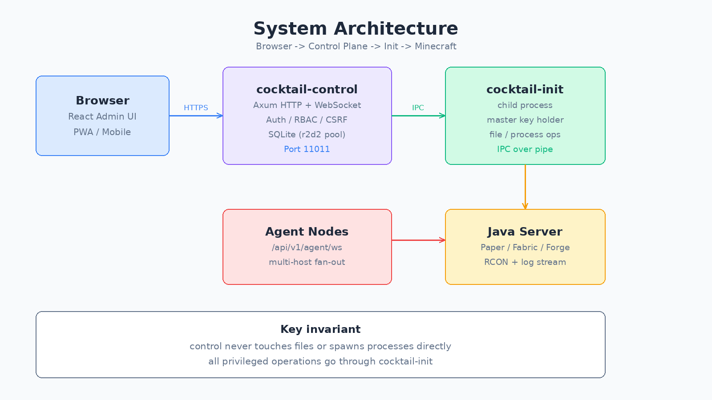
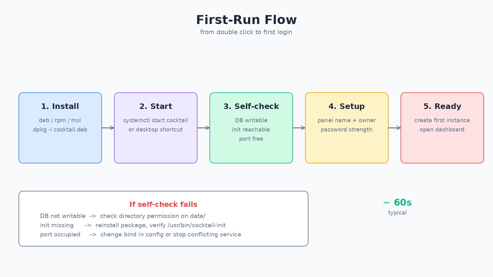
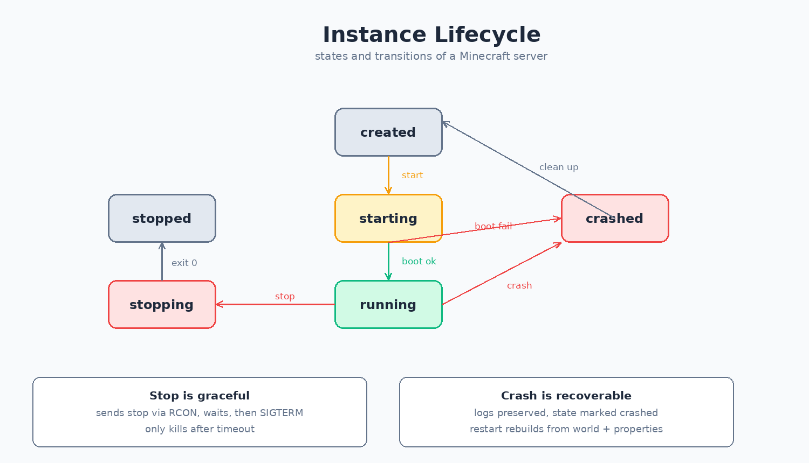
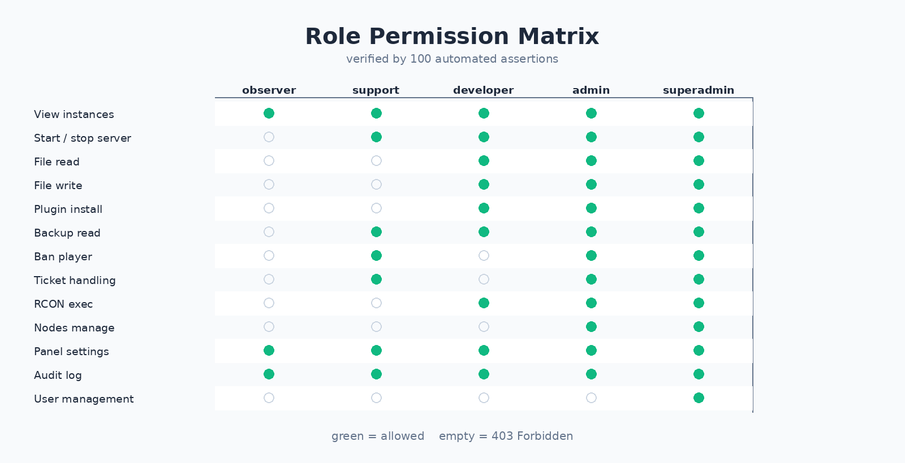
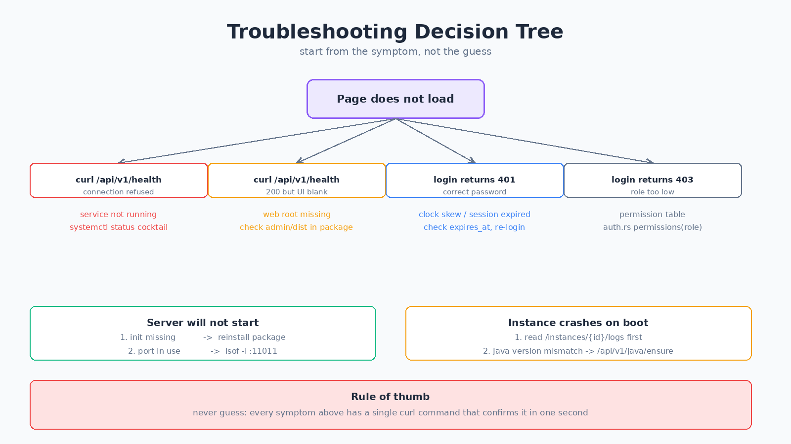

# Cocktail Manager 用户手册

> 面向：服主、开服新手、日常运维人员
> 版本：26Q4.11.DP

---

## 一、这是什么

Cocktail Manager 是一个开 Minecraft 服务器的管理面板。开完服之后，你在浏览器里就能：

- 启停服务器，看 CPU 和内存
- 装插件、改配置、传文件
- 踢人、封人、看谁在线
- 备份世界，回滚到之前的状态
- 统一管理多台机器上的多个服务端

不需要记命令行。所有操作都在网页上点。



上图是它的内部结构。你只需要知道两点：

1. 你的浏览器连的是**控制面**，它负责界面和账号。
2. 真正动文件和开进程的是它的**子进程 init**，控制面自己不碰文件。这是为了安全。

---

## 二、装之前先确认

### 硬件

| 项目 | 最低 | 说明 |
| --- | --- | --- |
| 内存 | 2 GB | 面板本身约 80 MB，剩下的给服务器 |
| 磁盘 | 20 GB | 一个原版世界加日志约 1-2 GB |
| CPU | 2 核 | 一个服务端至少 1 核 |

注意：面板和 Minecraft 服务端跑在同一台机器上时，请把服务端内存上限（`-Xmx`）设成总内存的 **70% 以下**，给系统和面板留余量。

### 系统

| 系统 | 支持情况 |
| --- | --- |
| Ubuntu 22.04 / 24.04 | 推荐 |
| Debian 12 | 支持 |
| CentOS / Rocky 9 | 支持（rpm） |
| Windows 10 / 11 | 支持（msi） |
| macOS | 不支持 |

### 你需要知道的一件事

面板默认监听 `11011` 端口。装完之后，浏览器访问：

```
http://你的服务器IP:11011
```

如果是家里的电脑或者云服务器，记得在防火墙放行这个端口。

---

## 三、第一次打开



### 第一步：看到自检页面

第一次打开会看到一个环境自检页面，它会自己检查四项：

| 检查项 | 通过的样子 |
| --- | --- |
| 控制面连通 | 绿色勾 |
| 数据库可读写 | 绿色勾 |
| 运行平台 | 显示你的系统和架构 |
| 插件宿主 | 绿色勾 |

**如果有任何一项是红的，不要继续点下一步。** 先解决它，否则后面一定出问题。

常见原因：

- **数据库不可写**：安装目录权限不对，需要让运行用户有 `data/` 目录的写权限
- **init 不存在**：安装包不完整，重新安装一次
- **WSL 环境提示端口**：Windows 的 WSL 需要额外放行端口，页面会给出提示

### 第二步：给面板起个名字

随便填，比如「小明的服务器」，这个只显示在页面顶部。

### 第三步：创建最高管理员

这里要填用户名和密码。密码有强度条，5 级。

**弱密码会被扣分**，比如 `12345678`、`password`、`admin123` 这类。请用至少 12 位、包含大小写和符号的密码。

这个账号是 Owner，权限最高，之后可以创建其他管理员。

> 如果忘记了密码，可以在服务器上执行：
> ```
> cocktail-control --reset-password
> ```

---

## 四、创建你的第一个服务器

登录后点左侧「实例」→「新建实例」。

### 填什么

| 字段 | 怎么填 |
| --- | --- |
| 名称 | 你自己看得懂就行，如「生存一区」 |
| 类型 | 原版 / Paper / Fabric / Forge，见下方说明 |
| 版本 | 会从官方列表自动拉取，选一个即可 |
| 端口 | 默认 25565，开第二个要改成 25566 |
| 内存 | 建议 2G 起步，人数多要加 |

### 类型怎么选

| 类型 | 适合 |
| --- | --- |
| 原版（Vanilla） | 只想和朋友纯净游玩 |
| Paper | 想装插件，性能也好，**大多数情况选这个** |
| Fabric | 想装模组，且模组是轻量的 |
| Forge | 想装大型模组整合包 |

如果你是新手，**直接选 Paper**。

### 创建之后会自动做什么

1. 下载对应版本的服务端 jar
2. 准备 `eula.txt`（Minecraft 的许可协议）
3. 生成基础 `server.properties`
4. 检查 Java 版本够不够，不够会提示安装

这些都不需要你手动做。

---

## 五、日常操作



### 启动 / 停止

| 操作 | 说明 |
| --- | --- |
| 启动 | 下载完成后启动，状态从「已创建」变「启动中」再变「运行中」 |
| 停止 | **优雅停止**：先发 stop 命令，等服务器自己保存退出，超时才强制杀 |
| 重启 | 停止 + 启动 |

**不要直接拔电源或 `kill -9`**。Minecraft 被强杀会导致世界文件损坏。面板的停止按钮已经是优雅的，正常用按钮就行。

### 看状态

面板主页会显示每个服的状态卡片：

- 绿色的点 = 正在运行
- 灰色的点 = 已停止
- 红色的点 = 崩溃了

点进去能看到 CPU、内存、在线人数、TPS。

### 改配置

「实例 → 配置」里可以直接改 `server.properties`：

| 常用项 | 说明 |
| --- | --- |
| `motd` | 服务器列表里显示的描述 |
| `max-players` | 最大人数 |
| `online-mode` | 正版验证，**盗版服要设 false** |
| `difficulty` | 难度 |
| `view-distance` | 视距，影响性能，8-10 比较合适 |
| `pvp` | 是否允许 PVP |

改完需要重启服务器才生效。

### 传文件

「实例 → 文件」可以浏览、上传、下载、编辑、删除。

**不要动这些文件**，除非你知道在做什么：

- `world/` 下的内容（地形数据）
- `*.jar`（服务端本体）
- `eula.txt` 改错会导致服务器不肯启动

---

## 六、装插件

「实例 → 插件」。

面板内置了三个插件源：

| 源 | 内容 |
| --- | --- |
| Hangar | Paper 生态的插件 |
| Modrinth | 插件和模组都有 |
| Spiget | SpigotMC 的插件 |

搜到插件点安装，面板会自动下 jar 放进 `plugins/` 目录。**装完要重启服务器。**

安装的插件可以在列表里启用/禁用，禁用的效果等同于把 jar 改名，不用手动操作文件。

---

## 七、管玩家

### 在线玩家

「实例 → 玩家」能看当前在线列表，每个玩家可以：

- 踢出（Kick）
- 封禁（Ban）
- 设为管理员（OP）
- 发送私聊

### 全局封禁

「社区 → 全局封禁」效果比单个实例封人更强：

- 可以按玩家名、IP、UUID 封
- 可以设置多久之后自动解封
- 可以指定只对哪几个服生效，或者全部生效

填写时两种方式选一种：

| 方式 | 例子 |
| --- | --- |
| 填小时数 | 填 `24` 表示一天后自动解封 |
| 填具体时间 | 选「2026-12-01 15:00」，到点自动解封 |

两个都填时，按具体时间算。填已经过去的时间会被拒绝，因为那等于没封。

### 工单

「社区 → 工单」是给玩家申诉的地方。玩家提交申诉、举报、求助，管理员在这里处理。

工单有几种状态，可以按状态筛选：

```
全部 (n)  待处理 (n)  处理中 (n)  已通过 (n)  已驳回 (n)
```

处理流程：

1. 看到「待处理」的工单，点「认领」，状态变「处理中」
2. 处理完点「通过」或「驳回」
3. 已结束的工单不能再改状态

### 排行榜

「社区 → 排行榜」按游玩时长排名，可以看：

- 每个人玩了多久
- 第一次来是什么时候
- 最后在线是什么时候
- 在几个服玩过

点某个人能看到档案：累计时长、会话数、来源 IP、封禁记录、被管理操作的次数。

---

## 八、备份

「实例 → 备份」。

### 手动备份

点一下「创建备份」，会打包当前世界文件。建议**在重大改动前手动备份一次**：

- 装新插件之前
- 改配置之前
- 升级服务端版本之前

### 恢复

点备份记录上的「恢复」。**恢复会覆盖当前世界**，所以恢复前建议先备份一次现状。

### 自动备份

「自动化」里可以设定时任务，比如每天凌晨 3 点自动备份、保留最近 7 份。

---

## 九、多台机器

「节点」页面可以把多台机器连成一个面板管。

### 添加节点

1. 点「添加节点」，填个名字
2. 系统给出一串 token，**只显示这一次，请立刻复制**
3. 在目标机器上装面板，用这个 token 连上来

### 状态

| 状态 | 含义 |
| --- | --- |
| 在线 | agent 已连上，可以操作 |
| 离线 | agent 没连上，只能看历史数据 |

新添加的节点一开始都是离线，要等那边的 agent 真正连上才会变在线。

> 本机节点是特殊的，永远显示在线，而且不能删除（删了面板自己就不可用了）。

---

## 十、权限

面板有 5 种角色，权限从小到大：



| 角色 | 适合谁 | 能做什么 |
| --- | --- | --- |
| 观察员 | 只想看不想改的人 | 看状态、看日志、看审计 |
| 客服 | 处理玩家问题的人 | 启停、封人、处理工单、看备份 |
| 开发者 | 改文件装插件的人 | 客服的全部 + 文件读写、插件、RCON |
| 管理员 | 管机器的人 | 除「管用户」外几乎全部 |
| Owner | 你自己 | 全部，包括管用户 |

三个反直觉但刻意如此的设计：

1. **管理员也不能创建管理员**。只有 Owner 能。防止有人偷偷给自己升级。
2. **观察员能看审计日志**。操作历史对所有人透明。
3. **客服不能建实例**。客服负责玩家，不负责开服。

---

## 十一、安全建议

### 必须做的

1. **改默认密码**。如果是脚本装的，确认没有弱口令。
2. **开 HTTPS**。面板前面放一层 Nginx 或 Caddy 做 TLS，否则密码是明文传的。
3. **别把 11011 直接暴露公网**。至少限制来源 IP。
4. **定期备份**，而且备份文件不要只放在同一块盘上。

### 建议做的

- 给每个管理员单独开账号，不要共用
- 不用的账号及时删除
- 定期看审计日志，尤其看登录失败记录
- 开启两步验证（如果启用）

---

## 十二、出问题了怎么查



### 页面打不开

先确认服务活着：

```
curl http://127.0.0.1:11011/api/v1/health
```

| 结果 | 说明 | 下一步 |
| --- | --- | --- |
| 返回 JSON | 服务正常 | 问题在浏览器或网络 |
| `Connection refused` | 服务没跑 | `systemctl status cocktail` |
| 超时 | 端口被防火墙挡了 | 检查防火墙规则 |

如果返回 JSON 但页面白屏，说明前端文件缺失，重装一次即可。

### 登录不了

| 情况 | 原因 |
| --- | --- |
| 密码对但提示 401 | 会话过期，或服务器时间不准 |
| 登录成功但什么都点不了 | 你的角色权限不够，找 Owner 升权 |
| 提示账号密码错误 | 确认大小写，或者用 `--reset-password` |

### 服务器启动不了

1. 先看日志：「实例 → 日志」，直接读最后的报错
2. 常见原因：
   - Java 版本不对（1.20 需要 Java 17+，1.21 需要 Java 21）
   - 内存设太大，机器扛不住
   - 端口被别的程序占了
   - 世界文件损坏（这时用备份恢复）

### 服务器运行中崩了

状态会变红显示「崩溃」。日志不会丢，先看日志找原因。常见的：

- 内存不足（看是不是设了 `-Xmx` 但机器内存不够）
- 某个插件报错（禁用它试试）
- 世界文件异常

---

## 十三、常见问题

**Q：能管理多少个服务器？**

只要内存和 CPU 撑得住，数量没有硬限制。但一台机器建议不超过 5 个活跃服务端。

**Q：面板崩了会影响正在跑的服务器吗？**

会。面板是父进程，面板挂了服务端会被一并停掉。所以建议用 systemd 托管，让它挂了自动重启。

**Q：能装模组吗？**

能，但服务端类型必须是 Fabric 或 Forge。Paper 只能装插件，不能装模组。

**Q：世界存档能导出吗？**

能。「实例 → 世界」可以下载，也可以导出成压缩包。

**Q：换机器怎么迁移？**

1. 在旧机器上把世界文件下载下来
2. 新机器装面板、建一个空实例
3. 把世界文件传上去
4. 启动

**Q：怎么升级面板？**

直接装新版包即可，数据会自动迁移。但**升级前请先备份 `data/` 目录**，以防万一。

**Q：忘记密码怎么办？**

在服务器终端执行 `cocktail-control --reset-password`，按提示重设。

---

## 十四、还需要帮助

- 站内「教程」页面有视频
- 「更新」页面能看到最新版本说明
- 遇到 bug 请附上：面板版本、日志片段、复现步骤

