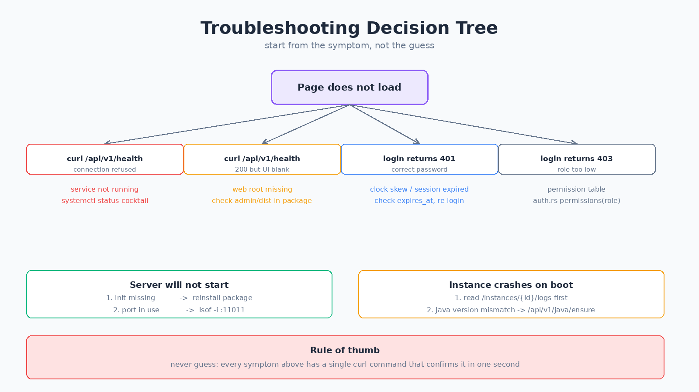

# Cocktail Manager 操作手册

> 面向：运维人员、部署工程师、需要上手的接管者
> 与《用户手册》的区别：这里写的是“具体怎么敲”，包括命令、路径、预期输出。

---

## 一、部署

### 1.1 Linux 包安装

```
# Debian / Ubuntu
sudo dpkg -i cocktail_26.4.11.0_amd64.deb

# RHEL / Rocky / CentOS
sudo rpm -ivh cocktail-26.4.11.0.x86_64.rpm
```

安装后会得到两个二进制：

| 路径 | 作用 |
| --- | --- |
| `/usr/bin/cocktail-control` | 控制面，你启动的这个 |
| `/usr/bin/cocktail-init` | 子进程，被 control 自动拉起 |

验证两个都在：

```
ls -l /usr/bin/cocktail-control /usr/bin/cocktail-init
```

**两个都必须存在。** 如果只有 control，说明包有问题，重新下载。

### 1.2 systemd 托管

```
sudo systemctl daemon-reload
sudo systemctl enable --now cocktail
sudo systemctl status cocktail
```

预期看到：

```
● cocktail.service - Cocktail Manager
     Loaded: loaded (/lib/systemd/system/cocktail.service; enabled)
     Active: active (running)
```

日志：

```
journalctl -u cocktail -f
```

正常启动的关键日志（这几行必须能看到）：

```
master key loaded from cocktail-init subprocess  source=init-rpc
cocktail-init init.starting
cocktail-init init.started  pid=9744  duration=9ms
serving admin UI  path=/usr/share/cocktail/admin
Cocktail Manager control plane v0.1 listening  addr=0.0.0.0:11011
```

如果只看到 `init.waiting` 没有 `init.started`，说明 init 没能启动，检查：

```
ls -l /usr/bin/cocktail-init
sudo -u cocktail /usr/bin/cocktail-init --version
```

### 1.3 手动前台运行（调试用）

排查问题时不要用 systemd，直接前台跑：

```
sudo -u cocktail \
  COCKTAIL_BIND=127.0.0.1:11011 \
  COCKTAIL_WEB_ROOT=/usr/share/cocktail/admin \
  RUST_LOG=debug \
  /usr/bin/cocktail-control
```

这样能直接看到所有日志，Ctrl+C 退出。

### 1.4 环境变量

| 变量 | 默认 | 说明 |
| --- | --- | --- |
| `COCKTAIL_BIND` | `0.0.0.0:11011` | 监听地址 |
| `COCKTAIL_WEB_ROOT` | `admin/dist` | 前端静态文件目录 |
| `COCKTAIL_DATA_DIR` | `data` | 数据库和运行数据目录 |
| `RUST_LOG` | `info` | 日志等级，排查时设 `debug` |

---

## 二、升级

### 2.1 标准流程

```
# 1. 先备份，一定要备份
sudo systemctl stop cocktail
sudo tar czf /backup/cocktail-data-$(date +%F).tar.gz /var/lib/cocktail/data

# 2. 装新包，直接覆盖
sudo dpkg -i cocktail_新版本.deb

# 3. 启动
sudo systemctl start cocktail

# 4. 验证
curl -s http://127.0.0.1:11011/api/v1/health
```

预期输出：

```json
{"name":"cocktail-control","status":"ok","setup_required":false,"os":"linux","arch":"x86_64"}
```

### 2.2 数据库自动迁移

启动时面板会自动补齐缺失的表和列，不需要手动执行 SQL。

迁移规则：

- 表不存在 → 创建
- 表已存在 → 跳过，但会补上缺失的列
- 已有数据保留

**升级后请立刻做一次登录测试**，确认老账号还能用。

### 2.3 回滚

```
sudo systemctl stop cocktail
sudo dpkg -i cocktail_旧版本.deb
sudo tar xzf /backup/cocktail-data-旧日期.tar.gz -C /
sudo systemctl start cocktail
```

注意：**从新版本回滚到旧版本，数据库可能不兼容**（旧版不认识新加的表）。所以更安全的做法是升级前先做一次数据快照。

---

## 三、日常巡检

### 3.1 每日检查（3 分钟）

```
# 服务活着吗
systemctl is-active cocktail

# 健康检查
curl -s http://127.0.0.1:11011/api/v1/health

# 磁盘还剩多少
df -h /var/lib/cocktail

# 导出磁盘了没有
du -sh /var/lib/cocktail/data
```

### 3.2 每周检查

```
# 错误日志
journalctl -u cocktail --since '7 days ago' -p err | tail -50

# 登录失败记录（可能有人在扫密码）
curl -s -H "Authorization: Bearer $TOKEN" \
  'http://127.0.0.1:11011/api/v1/audit?limit=100' | grep -i login_fail

# 备份是否正常生成
ls -lt /var/lib/cocktail/data/backups/ | head
```

### 3.3 需要关注的指标

| 指标 | 正常 | 异常时怎么办 |
| --- | --- | --- |
| 内存占用 | < 500 MB | 重启面板，查是否有实例泄漏 |
| 数据库大小 | < 500 MB | 清理审计日志、旧工单 |
| 备份数量 | 每服 < 30 份 | 清理旧的，或调小自动备份保留数 |
| 登录失败次数 | 每天 < 20 次 | 有人扫密码，限制来源 IP |

---

## 四、备份与恢复

### 4.1 面板自身的数据

需要备份的只有两个目录：

```
/var/lib/cocktail/data/
  ├── cocktail.db         ← 数据库，最重要
  └── backups/            ← 实例备份对象
```

一条命令：

```
sudo tar czf /backup/cocktail-$(date +%F-%H%M).tar.gz -C /var/lib/cocktail data
```

建议加到定时任务：

```
0 3 * * * root tar czf /backup/cocktail-$(date +\%F).tar.gz -C /var/lib/cocktail data
```

### 4.2 实例世界备份

面板内置了增量备份，比手动 tar 更省空间。

手动触发：

```
curl -X POST -H "Authorization: Bearer $TOKEN" \
  'http://127.0.0.1:11011/api/v1/instances/1/backups'
```

列出备份：

```
curl -H "Authorization: Bearer $TOKEN" \
  'http://127.0.0.1:11011/api/v1/instances/1/backups'
```

恢复：

```
curl -X POST -H "Authorization: Bearer $TOKEN" \
  'http://127.0.0.1:11011/api/v1/instances/1/backups/快照ID/restore'
```

### 4.3 检查备份是否真的可用

备份文件存在不等于能恢复。定期做一次演练：

```
# 建一个测试实例
curl -X POST -H "Authorization: Bearer $TOKEN" -H 'Content-Type: application/json' \
  -d '{"name":"restore-test","kind":"paper","version":"1.21.4","port":25599}' \
  'http://127.0.0.1:11011/api/v1/instances'

# 把生产环境的备份恢复到测试实例，启动看能不能跑
```

确认没问题后删掉测试实例。

---

## 五、账号管理

### 5.1 通过 API 创建账号

```
TOKEN="你的管理员token"

curl -X POST "http://127.0.0.1:11011/api/v1/users" \
  -H "Authorization: Bearer $TOKEN" \
  -H 'Content-Type: application/json' \
  -H "x-cocktail-csrf: $CSRF" \
  -d '{"username":"zhangsan","password":"强密码至少12位","role":"support"}'
```

注意 `x-cocktail-csrf` 这个头。缺失会返回 403。它的值从登录响应里拿，或者在 `/api/v1/auth/me` 里取。

### 5.2 角色对照

| 角色值 | 中文名 | 适合 |
| --- | --- | --- |
| `observer` | 观察员 | 只想看的 |
| `support` | 客服 | 处理玩家的 |
| `developer` | 开发者 | 改文件装插件的 |
| `admin` | 管理员 | 管机器的 |
| `superadmin` | Owner | 你自己 |

**只有 `superadmin` 能创建 `superadmin`**。管理员尝试创建会返回 400。

### 5.3 重置密码

面板账号：

```
sudo systemctl stop cocktail
sudo -u cocktail /usr/bin/cocktail-control --reset-password
sudo systemctl start cocktail
```

会提示输入新密码，交互式输入。

### 5.4 删除账号

```
curl -X DELETE "http://127.0.0.1:11011/api/v1/users/3" \
  -H "Authorization: Bearer $TOKEN" \
  -H "x-cocktail-csrf: $CSRF"
```

---

## 六、常见运维场景

### 6.1 导入现有服务器

如果你已经有一个在跑的 Minecraft 服务端，想接管它：

1. 停掉原来的启动方式（删掉原来的 `start.sh` 或 systemd 服务）
2. 在面板建一个相同类型和版本的实例，端口设成原端口
3. 把原来的世界目录覆盖到实例的 `world/`
4. 用面板启动

**注意**：原服务端的 `server.properties` 里有些项（比如 `online-mode`）请确认一下，不要被覆盖成默认值。

### 6.2 清理磁盘

磁盘快满时按这个顺序清理：

```
# 1. 看哪里占地方
du -sh /var/lib/cocktail/* | sort -h

# 2. 旧备份（最常见）
ls -lt /var/lib/cocktail/data/backups/ | tail -20

# 3. 审计日志
sqlite3 /var/lib/cocktail/data/cocktail.db \
  "DELETE FROM audit_log WHERE at < date('now','-90 days');"

# 4. 已关闭的工单
sqlite3 /var/lib/cocktail/data/cocktail.db \
  "DELETE FROM tickets WHERE state='rejected' AND created_at < date('now','-180 days');"
```

清理前先备份数据库。

### 6.3 迁移到新机器

```
# 旧机器
sudo systemctl stop cocktail
sudo tar czf /tmp/migrate.tar.gz -C /var/lib/cocktail data
scp /tmp/migrate.tar.gz newhost:/tmp/

# 新机器
sudo dpkg -i cocktail.deb
sudo systemctl stop cocktail
sudo tar xzf /tmp/migrate.tar.gz -C /var/lib/cocktail
sudo chown -R cocktail:cocktail /var/lib/cocktail/data
sudo systemctl start cocktail
```

启动后验证：

```
curl -s http://新机器IP:11011/api/v1/health
```

然后登录确认实例列表和用户都在。

### 6.4 添加第二台节点

```
# 在主控上创建节点
curl -X POST "http://主控:11011/api/v1/nodes" \
  -H "Authorization: Bearer $TOKEN" \
  -H 'Content-Type: application/json' \
  -H "x-cocktail-csrf: $CSRF" \
  -d '{"name":"edge-01"}'
```

响应里包含 `token`，**只返回这一次**。在目标机器上用它连接：

```
/api/v1/agent/ws?token=刚才拿到的token
```

---

## 七、故障排查



### 7.1 服务起不来

按顺序查：

```
# 第1步：看日志
journalctl -u cocktail -n 50 --no-pager

# 第2步：端口占用？
sudo ss -tlnp | grep 11011

# 第3步：init 在吗
ls -l /usr/bin/cocktail-init

# 第4步：数据目录权限
ls -ld /var/lib/cocktail/data
sudo -u cocktail touch /var/lib/cocktail/data/.wtest && echo writable
```

| 日志关键字 | 含义 | 处理 |
| --- | --- | --- |
| `Address already in use` | 端口被占 | 停掉冲突程序或改端口 |
| `no such file` | init 缺失 | 重装包 |
| `Permission denied` | 权限不对 | `chown -R cocktail:cocktail` |
| `database is locked` | 有进程占着库 | 确认没有第二个实例在跑 |
| `table xxx has no column` | 数据库版本不匹配 | 升级到对应版本，或恢复备份 |

### 7.2 页面能开但登录后什么都做不了

八成是权限问题，不是 bug。

```
# 看看自己是什么角色
curl -H "Authorization: Bearer $TOKEN" http://127.0.0.1:11011/api/v1/auth/me
```

返回里的 `role` 字段就是你的角色。对照第五节的表。

如果是 `observer`，那只能看，所有写操作都会返回 403。

### 7.3 实例启动后马上变崩溃

```
# 看日志
curl -H "Authorization: Bearer $TOKEN" \
  'http://127.0.0.1:11011/api/v1/instances/1/logs?lines=100'
```

常见报错：

| 报错 | 原因 | 处理 |
| --- | --- | --- |
| `UnsupportedClassVersionError` | Java 版本太低 | 装对应版本 Java |
| `Failed to bind to port` | 端口被占 | 换端口 |
| `You need to agree to the EULA` | eula 没同意 | 面板里点同意，或改 `eula.txt` |
| `OutOfMemoryError` | 内存不够 | 调小 `-Xmx` 或加内存 |
| `Failed to load world` | 世界损坏 | 用备份恢复 |

### 7.4 数据库损坏

先检查：

```
sqlite3 /var/lib/cocktail/data/cocktail.db "PRAGMA integrity_check;"
```

正常应该输出 `ok`。如果输出一堆错误：

```
# 尝试修复
sqlite3 /var/lib/cocktail/data/cocktail.db ".recover" > /tmp/recovered.sql

# 导入到新库
sqlite3 /tmp/new.db < /tmp/recovered.sql
```

成功率不高时直接恢复备份更靠谱。

### 7.5 内存占用一直涨

```
# 看进程
ps aux | grep cocktail | head

# 看系统内存
free -h
```

如果是 control 本身涨，重启能缓解，但要查是哪个接口泄漏。如果是子进程（Minecraft 服务端）涨，那是正常的，但要确认 `-Xmx` 设得合理。

---

## 八、API 速查

### 认证

```
# 登录（拿 token 和 csrf）
POST /api/v1/auth/login
  {"username":"admin","password":"xxx"}

# 当前用户信息
GET /api/v1/auth/me

# 登出
POST /api/v1/auth/logout

# 改密码
POST /api/v1/auth/password
  {"old_password":"xxx","new_password":"yyy"}
```

所有写操作都要带两个头：

```
Authorization: Bearer <token>
x-cocktail-csrf: <csrf_token>
```

### 实例

```
GET    /api/v1/instances              列表
POST   /api/v1/instances              创建
GET    /api/v1/instances/{id}         详情
DELETE /api/v1/instances/{id}         删除
POST   /api/v1/instances/{id}/start   启动
POST   /api/v1/instances/{id}/stop    停止
POST   /api/v1/instances/{id}/restart 重启
GET    /api/v1/instances/{id}/logs    日志
GET    /api/v1/instances/{id}/metrics 指标
```

### 玩家

```
GET  /api/v1/instances/{id}/players               在线列表
GET  /api/v1/instances/{id}/players/history       历史
GET  /api/v1/instances/{id}/players/{name}/detail 详情
POST /api/v1/instances/{id}/players/{name}/kick   踢出
POST /api/v1/instances/{id}/players/{name}/ban    封禁
POST /api/v1/instances/{id}/players/{name}/op     给OP
```

### 社区

```
GET    /api/v1/bans?limit=100        封禁列表
POST   /api/v1/bans                  新增封禁
DELETE /api/v1/bans/{id}             解除封禁
GET    /api/v1/tickets?limit=100     工单列表
POST   /api/v1/tickets               提交工单
POST   /api/v1/tickets/{id}/claim    认领
POST   /api/v1/tickets/{id}/approve  通过
POST   /api/v1/tickets/{id}/reject   驳回
GET    /api/v1/leaderboard?limit=50  排行榜
GET    /api/v1/profiles/{name}       玩家档案
```

### 节点

```
GET    /api/v1/nodes        列表
POST   /api/v1/nodes        创建（返回一次性 token）
DELETE /api/v1/nodes/{id}   删除（本机不能删）
```

---

## 九、上线前检查清单

复制这份清单，逐项打勾：

```
[ ] 两个二进制都存在（control + init）
[ ] systemd 已 enable，重启机器后自动起来
[ ] 健康检查返回 200
[ ] 默认密码已改，不是弱口令
[ ] 前面有 HTTPS（Nginx/Caddy）
[ ] 11011 没有直接暴露公网
[ ] 数据目录有定时备份
[ ] 备份演练过至少一次恢复
[ ] 所有管理员都是独立账号
[ ] 审计日志能正常查看
[ ] 磁盘剩余 > 20%
[ ] 一个实例能正常启停
[ ] 崩了的实例能从日志看出原因
```

---

## 十、紧急处理

### 面板被入侵了

```
# 1. 立刻断网
sudo systemctl stop cocktail
iptables -A INPUT -p tcp --dport 11011 -j DROP

# 2. 保留现场
sudo tar czf /tmp/incident-$(date +%s).tar.gz \
  /var/lib/cocktail/data /var/log/journal

# 3. 看审计日志找入口
sqlite3 /var/lib/cocktail/data/cocktail.db \
  "SELECT * FROM audit_log ORDER BY at DESC LIMIT 100;"

# 4. 改所有密码，删可疑账号
# 5. 升级到最新版本，补上漏洞
```

### 磁盘满了导致服务挂了

```
# 1. 腾出空间（先删最安全的东西）
find /var/lib/cocktail/data/backups -name '*.obj' -mtime +30 -delete
journalctl --vacuum-time=7d

# 2. 重启
sudo systemctl start cocktail

# 3. 检查数据库完整性
sqlite3 /var/lib/cocktail/data/cocktail.db "PRAGMA integrity_check;"
```

磁盘满时 SQLite 写入会失败，可能留下半截事务，所以一定要做完整性检查。

