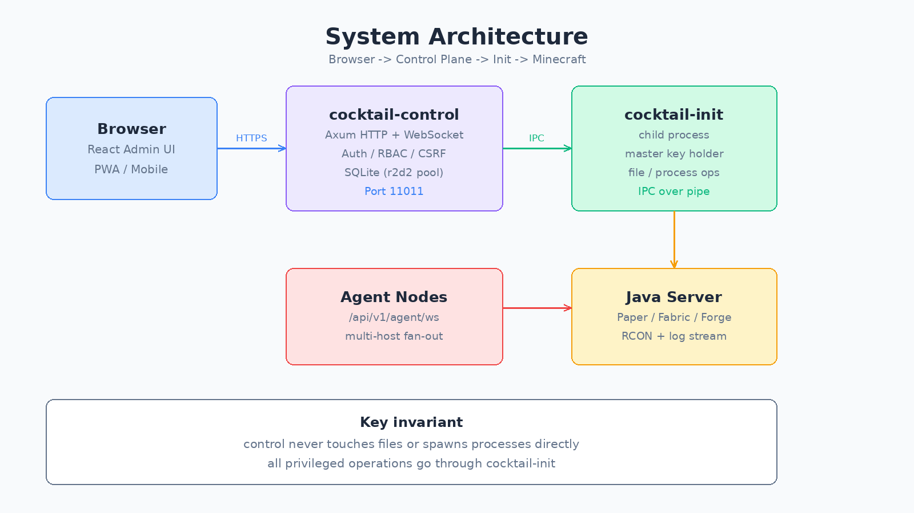
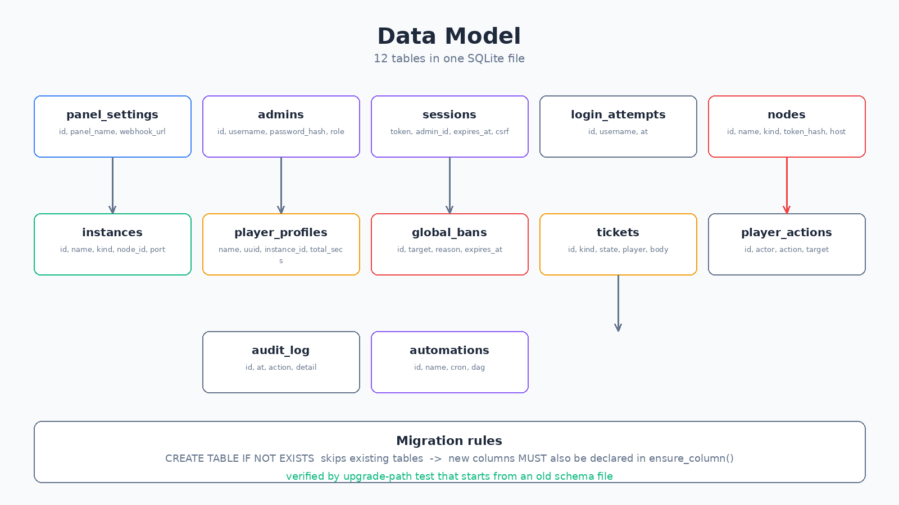
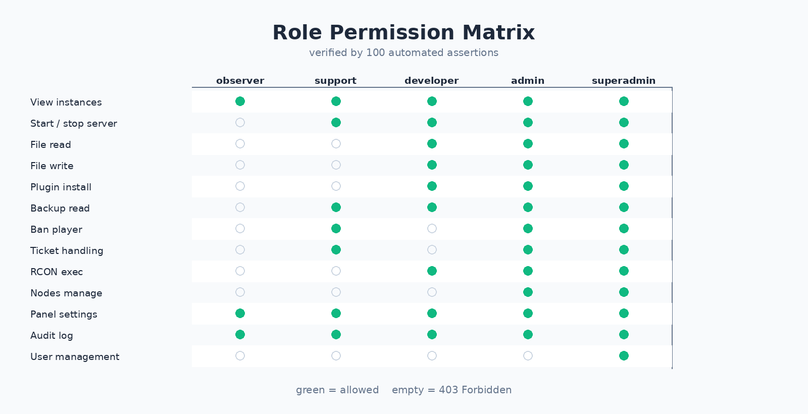
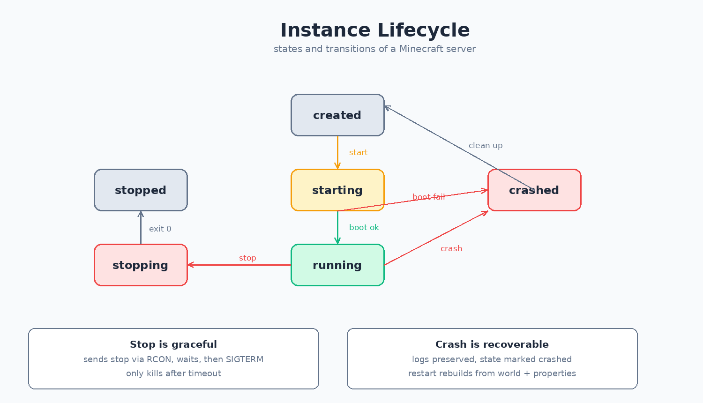
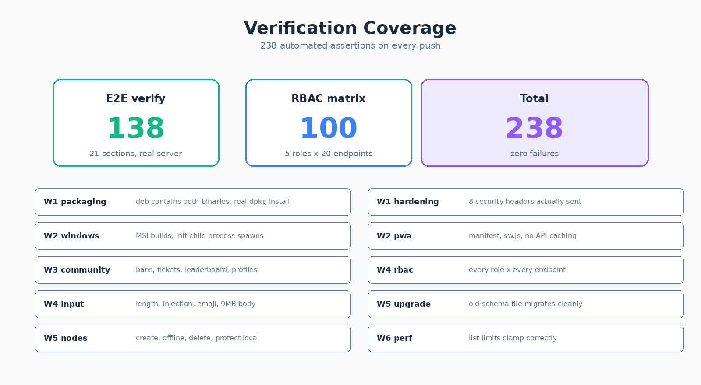

# Cocktail Manager 设计说明书

> 面向：后续维护者、代码审查者、想懂内部的人
> 本文记录的是“为什么这样设计”，不是“怎么用”。

---

## 一、设计目标

### 1.1 要解决的问题

市面上的 Minecraft 面板大多是：

- 只支持单一服类型
- 只能单机，不能多机统一管
- 装完不会用，文档全是英文
- 安全粗糙（明文密码、无 CSRF、无权限分级）

Cocktail 的定位：**开箱能用的多实例面板，安全与易用优先于功能数量**。

### 1.2 四条设计原则

| 原则 | 具体含义 |
| --- | --- |
| 装上就能跑 | 安装包必须自包含，不依赖用户手动补文件 |
| 权限最小化 | 每个角色只能做职责内的事，越权一律 403 |
| 失败要能查 | 异常必须留下可读日志，不静默失败 |
| 数据不能丢 | 迁移、备份、恢复必须可逆 |

---

## 二、整体架构



### 2.1 为什么拆成两个进程

面板要干两类事：

1. **对外提供服务**：HTTP、WebSocket、鉴权、渲染
2. **对内执行特权操作**：写文件、开进程、杀进程

如果放在同一个进程里，处理 HTTP 的代码一旦被控制，攻击者就能直接操作文件系统。

所以拆成：

| 进程 | 职责 | 特权 |
| --- | --- | --- |
| `cocktail-control` | 网络、鉴权、业务逻辑 | 不提权，只做 IPC |
| `cocktail-init` | 文件操作、进程管理、密钥持有 | 受限上下文 |

**关键约束：control 从不直接碰文件。** 所有文件与进程操作都通过 IPC 请 init 做。

代价是多一层通信（实测启动握手约 9ms），换来攻击面隔离。

### 2.2 master key 的传递

加密主密钥由 init 生成并持有，启动时通过 IPC 交给 control：

```
master key loaded from cocktail-init subprocess  source=init-rpc
```

为什么不让 control 自己生成？因为如果 control 被攻破，密钥不应该能被重新生成（那样旧数据就再也解不开）。由 init 持有，恢复数据必须 init 配合。

### 2.3 技术栈选型

| 层 | 选型 | 理由 |
| --- | --- | --- |
| 后端 | Rust + Axum | 内存安全，无 GC 停顿，单二进制部署 |
| 数据库 | SQLite + r2d2 连接池 | 单机零运维，备份就是拷文件 |
| 前端 | React + TypeScript + Vite | 生态成熟，类型安全，构建快 |
| 实时 | WebSocket | 日志、指标、事件推送 |
| 插件 | WebAssembly | 沙箱隔离，插件崩了不影响主进程 |

为什么不用 PostgreSQL？典型部署是一台 VPS 开两三个服，装 PG 是负担。SQLite 在 WAL 模式下并发读足够好，且备份极其简单。

---

## 三、模块划分

### 3.1 后端

| 模块 | 职责 | 行数量级 |
| --- | --- | --- |
| `lib.rs` | 路由挂载、中间件链、权限映射 | 1200 |
| `db.rs` | 全部 SQL 访问、schema 与迁移 | 1900 |
| `auth.rs` | 密码、会话、权限表（实际生效版） | 400 |
| `rbac.rs` | 角色定义（与 auth.rs 需保持一致） | 350 |
| `instance.rs` | 实例生命周期 | 900 |
| `cluster.rs` | 多节点、agent 接入 | 340 |
| `backup.rs` | 增量备份与 GFS 策略 | 700 |
| `crypto.rs` | SHA256 / HMAC / HKDF / ChaCha20 | 300 |
| `secrets.rs` | 主密钥与字段加密 | 200 |
| `hardening.rs` | CIDR、限流、安全响应头 | 250 |
| `metrics.rs` | Prometheus 指标与告警 | 600 |
| `workflow.rs` | DAG 工作流与 Cron | 500 |
| `identity.rs` | OIDC / LDAP / JWT | 400 |
| `community.rs` | 封禁、工单、画像纯逻辑 | 500 |
| `release_check.rs` | 版本比较与更新检查 | 520 |
| `tutorials.rs` | 教程清单与播放进度 | 460 |

### 3.2 前端

| 文件 | 职责 |
| --- | --- |
| `App.tsx` | 主框架，所有页面挂载点，约 2900 行 |
| `api.ts` | 全部 API 定义，约 1500 行 |
| `hashRoute.ts` | 路由类型联合 |
| 各页面组件 | 每功能一个独立文件 |

前端没有引入状态管理库。原因：页面之间共享状态很少，全局 store 反而增加复杂度。

---

## 四、数据库设计



### 4.1 表结构原则

- 主键用 `TEXT`（UUID / 随机 token）或 `INTEGER AUTOINCREMENT`
- 时间统一 RFC3339 字符串，不用 Unix 时间戳（可读、跨语言无歧义）
- 布尔值用 `INTEGER 0/1`
- 开启外键（`PRAGMA foreign_keys = ON`）
- WAL 模式（读写不互相阻塞）
- `busy_timeout = 15000`（并发写时等待而非立刻失败）

### 4.2 迁移机制（最容易踩坑的地方）

迁移函数 `migrate()` 做两件事：

```rust
CREATE TABLE IF NOT EXISTS xxx (...)    // 建表，对已存在的表无效
ensure_column(conn, "表", "列", "类型")   // 补列，幂等
```

**铁律：新增列时必须同时改两处。**

只改 `CREATE TABLE` 的后果：

- 新装用户：正常
- 老用户升级：表已存在，`CREATE TABLE IF NOT EXISTS` 直接跳过，新列根本没建，一用就报 `no column named xxx`

W5 验证时挖出了两个真实 bug，都属此类：

1. `panel_settings.webhook_url` 缺失，且紧随其后的 `INSERT` 引用了它，导致整个迁移报错、**服务启动失败**
2. `nodes` 表缺 5 个列（`token_hash`/`hostname`/`os`/`arch`/`last_seen`），多节点功能一用就挂

第二个更隐蔽：它不影响启动，只是功能不可用。

### 4.3 为什么不用版本号迁移

常见做法是 `PRAGMA user_version` + 顺序脚本。这里选幂等补列，因为：

- 用户可能跳版本升级（26Q1 直接装 26Q4）
- 顺序脚本要求严格按版本链跑，跳版本会漏步
- 幂等补列无论从哪条路径升上来，终态都一致

代价是每次启动做一次 `PRAGMA table_info`（12 张表），耗时可忽略。

---

## 五、安全设计

### 5.1 密码与密钥

| 项 | 方案 |
| --- | --- |
| 密码存储 | Argon2id 哈希，每用户独立 salt |
| 会话 token | 32 字节随机，存在 sessions 表 |
| 会话过期 | 默认 7 天，`expires_at` 字段控制 |
| CSRF token | 每会话一个，写操作必须带 `x-cocktail-csrf` 头 |
| 字段加密 | ChaCha20-Poly1305，密钥来自 init |
| 密钥派生 | HKDF-SHA256 |

为什么用 Argon2id 而不是 bcrypt？Argon2 是密码哈希竞赛的最终推荐，抗 GPU 破解能力更强。

### 5.2 CSRF 防护

所有写操作（POST/PUT/DELETE）必须带 `x-cocktail-csrf` 头，值与会话里存的一致。

这是 W4 验证时踩过的坑：脚本用了 `X-CSRF-Token`，全部 403，改了 14 处才对。

**为什么不用双重提交 Cookie？** 因为面板大量使用 Bearer token 而非 Cookie，双重提交的前提不成立。

### 5.3 安全响应头

`hardening.rs` 定义 8 个响应头：

| 头 | 值 | 作用 |
| --- | --- | --- |
| `Content-Security-Policy` | `default-src 'self'` | 限制资源加载源 |
| `X-Frame-Options` | `DENY` | 禁止被 embed |
| `X-Content-Type-Options` | `nosniff` | 禁止 MIME 嗅探 |
| `Referrer-Policy` | `no-referrer` | 不泄露来源 |
| `Permissions-Policy` | 关闭相机/麦克风等 | 最小授权 |
| `Cross-Origin-Opener-Policy` | `same-origin` | 进程隔离 |
| `Cross-Origin-Resource-Policy` | `same-origin` | 资源不跨域 |
| `X-Permitted-Cross-Domain-Policies` | `none` | 禁 Flash/PDF 跨域 |

**重要历史**：这些头在代码里写好了，但曾经**全仓库没有任何地方调用**。写了不等于生效。是端到端验证才发现的，后来在 `lib.rs` 加了 `apply_security_headers` 中间件挂到 Router 最外层。

这条教训写进验收清单：安全头必须有测试用例，不能靠“代码里有”来判断。

### 5.4 限流

`login_attempts` 表记录每次登录尝试，同一用户名短时间失败过多会暂时锁定。

### 5.5 输入校验

两层：

1. **长度与字符**：`check_len()` 统一校验，用 `chars().count()` 而不是 `len()`（否则中文按字节算会误判）
2. **SQL 参数化**：全部用 `params![]` 占位符，无字符串拼接

字段上限：

| 字段 | 上限 |
| --- | --- |
| 封禁目标 | 64 |
| 封禁原因 | 512 |
| 玩家名 | 64 |
| 工单主题 | 200 |
| 工单正文 | 8000 |

控制字符会被拒（除 `\n` 与 `\t`）。

### 5.6 请求体上限

| 路由 | 上限 |
| --- | --- |
| 默认 | 8 MB |
| 文件上传 | 2 GB |

原本默认是 2 GB，任何登录用户几个并发请求就能打爆内存。W4 验证时改成差异化限制。

---

## 六、权限设计



### 6.1 五角色

| 角色 | 定位 | 权限数 |
| --- | --- | --- |
| `observer` | 只读观察 | 2 |
| `support` | 客服，处理玩家 | 8 |
| `developer` | 开发者，动文件 | 13 |
| `admin` | 管理员，管机器 | 17 |
| `superadmin` | Owner | 全部 |

### 6.2 两套权限表（重要历史遗留问题）

| 文件 | 函数 | 状态 |
| --- | --- | --- |
| `auth.rs` | `permissions(role)` | **实际生效**，中间件 `auth::can()` 用它 |
| `rbac.rs` | `Role::new(...)` 里的列表 | 与 auth.rs 一致性参考 |

这是上游遗留的架构问题。改权限时**两个文件都要改**，否则会出现“改了没生效”或“定义与实际不符”。

发现过程：最初只改 `rbac.rs`，测试毫无变化，顺着 `auth::can` 才找到真正生效的那份。

### 6.3 权限粒度

设计上把读和写分开：

```
plugins      写权限
plugins.read 读权限（新增）
backups      写权限
backups.read 读权限（新增）
```

为什么要分？因为原来的设计里 `/plugins` 和 `/backups` 读操作只要求 `view`，而 observer 有 `view`——观察员能看到装了什么插件（暴露漏洞面）、有哪些备份（暴露文件结构）。而 `/files` 读要求 `files.read`，三处粒度不一致。W4 验证时修复。

### 6.4 三个反直觉但正确的设计

1. **admin 不能管用户**。只有 superadmin 有 `users` 权限。防止管理员自我提权。
2. **observer 能看审计**。`/audit` 读只要求 `view`，操作历史对全员透明。
3. **support 不能建实例**。客服职责是玩家，不是开服。

---

## 七、实例生命周期



### 7.1 状态机

```
created -> starting -> running -> stopping -> stopped
                  \-> crashed
```

### 7.2 为什么停止要优雅

Minecraft 被强杀会导致：

- 世界文件半写入（chunk 损坏）
- 区域文件锁未释放
- 玩家数据丢失

所以停止顺序是：

1. 通过 RCON 发 `stop`
2. 等待进程自行退出（默认 30s）
3. 超时才 SIGTERM
4. 再超时 SIGKILL

### 7.3 崩溃检测

进程意外退出时：

- 状态置为 `crashed`
- 保留日志
- 不自动重启（避免崩溃循环）

为什么不做自动重启？如果是因为配置错误导致崩溃，自动重启会一直循环，把日志刷爆也找不到原因。由人工确认后再启动更安全。

### 7.4 并发控制

同一实例的启停操作力互斥。两个管理员同时点启动，只有一个生效，另一个拿到“已在进行中”的提示，不会启动两个 JVM。

---

## 八、社区功能设计

### 8.1 三张表的职责

| 表 | 职责 |
| --- | --- |
| `global_bans` | 跨实例封禁，支持限时与范围 |
| `tickets` | 玩家申诉/举报/求助的工单 |
| `player_actions` | 所有管理操作的流水 |

为什么要单独一张 `player_actions` 而不是只看 `audit_log`？因为审计日志记录的是“谁对系统做了什么”（管理员视角），而 player_actions 记录的是“谁对玩家做了什么”（玩家视角），查询模式完全不同。

### 8.2 封禁的两种时限

```rust
match body.expires_at {
    Some(raw) if !raw.is_empty() => {
        let utc = parse_rfc3339(raw)?;
        if utc <= Utc::now() { return Err(bad_request("到期时间必须晚于当前时间")); }
        Some(utc.to_rfc3339())
    }
    _ => body.hours.filter(|h| *h > 0).map(|h| (Utc::now() + Duration::hours(h)).to_rfc3339()),
}
```

两种都支持的原因：

- `hours` 适合脚本调用（“封 24 小时”）
- `expires_at` 适合人机交互（“封到明天下班”）

两者都给时 `expires_at` 优先，语义更精确。拒绝过去时间是因为那等于没封。

### 8.3 工单状态机

```
open --claim--> claimed --approve--> approved
                       \--reject---> rejected
```

约束：已结束（approved/rejected）的工单不能再变更状态。这样处理历史是确定的，不会出现“已通过的又被驳回”。

### 8.4 排行榜的聚合方式

**用 SQL 聚合，不是内存算：**

```sql
SELECT name, MAX(uuid), SUM(total_secs), MIN(first_seen), MAX(last_seen),
       COUNT(instance_id)
FROM player_profiles
GROUP BY name
ORDER BY SUM(total_secs) DESC
LIMIT ?1
```

为什么重要？如果把玩家数据全部拉进内存再 group，玩家一多（几千人）就会把内存吃满。SQLite 的 GROUP BY 在有索引时很快。

### 8.5 风险评分

玩家档案里的风险评分是启发式的，看三个信号：

- 来源 IP 数量（多个 IP 可能是在换号）
- 被封禁次数
- 平均会话时长（很短的会话可能是小号）

这不是精确判定，只是给管理员一个提示。

---

## 九、备份设计

### 9.1 增量 vs 全量

备份采用**内容寻址 + 去重**：

- 每个文件块算哈希
- 相同的块只存一份
- 快照只存“块哈希列表”

好处：10 个快照如果世界只改了 1%，磁盘占用约是 1.1 倍而非 10 倍。

### 9.2 GFS 保留策略

Grandfather-Father-Son：

| 层级 | 保留 |
| --- | --- |
| 小时级 | 最近 24 份 |
| 日级 | 每天 1 份，保留 7 天 |
| 周级 | 每周 1 份，保留 4 周 |
| 月级 | 每月 1 份，保留 6 月 |

自动清理时从最老的层级开始删。

### 9.3 原子性

备份创建过程中不会修改源文件。恢复时：

1. 先解到临时目录
2. 校验完整性
3. 原子替换

如果中途失败，原世界不受影响。

---

## 十、多节点设计

### 10.1 通信方式

agent 用 WebSocket 主动连主控：

```
/api/v1/agent/ws?token=xxx
```

为什么不是主控连 agent？因为：

- agent 可能在 NAT 后面，没有公网 IP
- 主动出站连接穿透性更好
- token 验证只需要在主控侧做

### 10.2 在线判定

```rust
let online = n.kind == "local" || agents.contains_key(&n.id);
```

本机节点恒在线（它就在本进程里），远端节点看连接表。

### 10.3 本机节点保护

```rust
if crate::instance::is_local_node(id) {
    anyhow::bail!("不能删除本机节点");
}
```

如果允许删本机节点，控制面会失去对所有本地实例的管理能力，相当于把自己搞残。

### 10.4 token 一次性

创建节点时返回的 token 只显示一次，数据库里存的是哈希。丢了不能找回，只能删了重建。这是安全与可恢复性的权衡。

---

## 十一、性能设计

### 11.1 列表分页

所有列表接口都有上限：

| 接口 | 默认 | 最大 |
| --- | --- | --- |
| `/tickets` | 500 | 2000 |
| `/bans` | 2000 | 5000 |
| `/player-actions` | 100 | 2000 |
| `/leaderboard` | 50 | 200 |

用 `clamp()` 而非报错：传 99999 时静默夹到上限。理由：管理面板翻页时调大 limit 是正常操作，报错反而打断用户。保护的目的只是防一次拉全表。

### 11.2 连接池

r2d2 连接池，默认大小 8。SQLite 的写是串行的，池太大没意义。

### 11.3 前端优化

- 大列表用虚拟滚动
- 日志用 WebSocket 增量推送，不全量轮询
- PWA 缓存静态资源，但**绝对不缓存 API**（否则会看到过期的实例状态）

---

## 十二、验证体系



### 12.1 三层验证

| 层 | 工具 | 覆盖 |
| --- | --- | --- |
| 编译 | CI（rustfmt + clippy + test） | 语法、lint、单测 |
| 端到端 | `scripts/e2e_verify.sh` | 138 项真实请求 |
| 权限 | `scripts/rbac_matrix.sh` | 100 项角色×端点 |

### 12.2 为什么必须有端到端

因为“编译通过”≠“功能生效”。本项目的两个例子：

1. **安全响应头写了但从不调用**：代码存在，单测能过，但一个头都没发出去
2. **安装包漏打 init**：编译正常，装完直接不可用

这两个都只有真的启动服务、真的发请求才能发现。

### 12.3 升级路径测试

关键测试：构造一个“旧版数据库”（缺列、缺表），用当前二进制启动，验证能否自动迁移。

W5 挖出的两个阻断级 bug 就是这个测试发现的。如果只测新装，这两个 bug 会一直潜伏到用户升级时才爆发。

### 12.4 测试本身的坑

脚本自己也会错。经验：

| 现象 | 实际问题 |
| --- | --- |
| 26 个失败 | CSRF 头名写错（用了 `X-CSRF-Token`） |
| 迁移全缺失 | 数据库文件名写错（`control.db` vs `cocktail.db`） |
| 8 处 `-d: command not found` | heredoc 里反斜杠被多转义一层 |

教训：**验证脚本自己也需验证**。第一次大量失败时，先怀疑脚本，再怀疑产品。

---

## 十三、技术债与改进方向

### 13.1 已知问题

| 问题 | 影响 | 建议 |
| --- | --- | --- |
| 两套权限表（auth.rs / rbac.rs） | 改权限容易漏改 | 中期重构为单一数据源 |
| 排行榜全表 GROUP BY | 玩家量极大时变慢 | 加物化视图或定时聚合表 |
| 前端无分页组件 | 大列表全靠 limit 截断 | 加游标分页 |
| control 与 init 用 pipe IPC | 高并发下可能成瓶颈 | 考虑 Unix socket |

### 13.2 不建议做的事

- **不建议改成多进程 worker 模型**。SQLite 写是串行的，多 worker 反而增加锁竞争。
- **不建议引入 ORM**。当前 SQL 都是手写的，性能可预测，换成 ORM 会失去控制。
- **不建议把日志存数据库**。日志用文件 + journald，数据库只存结构化数据。

---

## 十四、开发约定

### 14.1 代码风格

- **零注释**（`//`、`/* */`、文档注释都不用）
- 命名即文档，函数名要能说清楚做什么
- 不使用 `unwrap()`，除非能证明不会 panic
- 错误用 `anyhow::Result` 向上传递，接口层统一转 HTTP 状态码

为什么零注释？因为注释会过期——代码改了注释不改，比没注释更危险。靠命名和结构表达意图。

### 14.2 新增接口的四个步骤

1. `api/handlers/xxx.rs` 写 handler
2. `api/handlers/mod.rs` 注册 `mod xxx;` 与 `pub use xxx::*;`
3. `api/mod.rs` 加 `.route(...)`
4. `lib.rs` 的 `required_perm` 加权限映射

漏了第 4 步，接口默认无权限校验。

### 14.3 新增页面的六个步骤

1. `hashRoute.ts` 的 `HomeTab` 加类型
2. `App.tsx` 加 import
3. `PLANE_LINKS` 加入口
4. 渲染链加分支
5. `lib.rs` 的 `required_perm` 加权限
6. `api.ts` 加类型与方法

### 14.4 提交前检查

```
[ ] cargo fmt --all 干净
[ ] 注释数量为 0
[ ] CI 全绿
[ ] E2E 全绿（138 项）
[ ] 权限矩阵全绿（涉及权限时）
[ ] 新增列同时改了 CREATE TABLE 和 ensure_column
[ ] 新增接口加了 required_perm
```

---

## 十五、术语表

| 术语 | 含义 |
| --- | --- |
| control | `cocktail-control`，主进程，对外提供 HTTP/WS |
| init | `cocktail-init`，control 的子进程，执行特权操作 |
| master key | 主密钥，由 init 生成持有，用于字段加密 |
| setup | 首次启动向导，创建 Owner 账号 |
| CSRF | 跨站请求伪造防护，头名 `x-cocktail-csrf` |
| observer | 观察员，只读 |
| support | 客服，处理玩家与工单 |
| developer | 开发者，可动文件与插件 |
| admin | 管理员，可管节点与设置，但不能管用户 |
| superadmin | Owner，全部权限 |
| instance | 一个 Minecraft 服务器实例 |
| node | 一台物理机/虚拟机，可承载多个实例 |
| agent | 运行在远端节点上的连接进程 |
| snapshot | 备份快照，内容寻址存储 |
| GFS | Grandfather-Father-Son，备份保留策略 |
| DP | 开发预览版本阶段 |
| GA | 正式发布阶段 |
| LTS | 长期支持阶段 |
| ensure_column | 迁移中补列的函数，幂等 |

