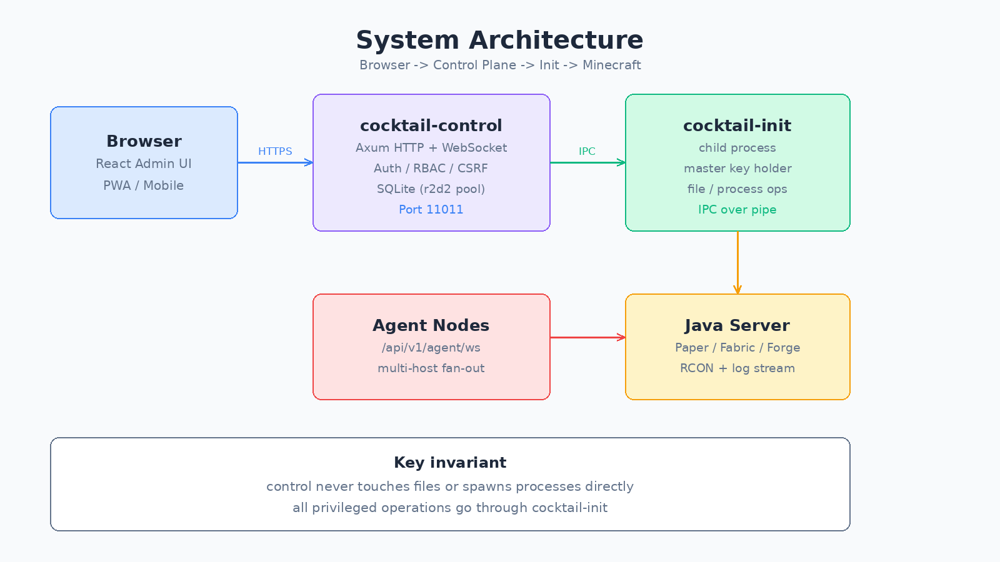
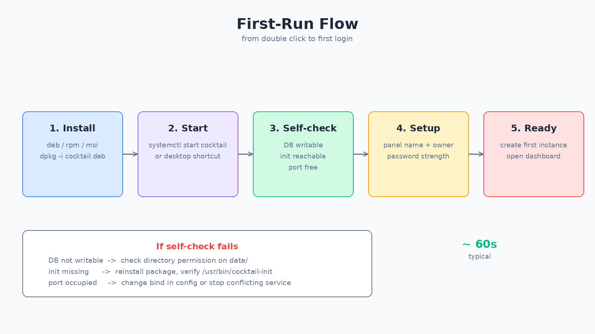
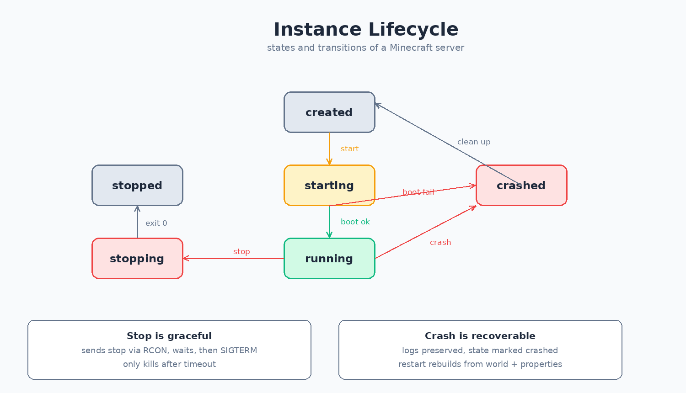
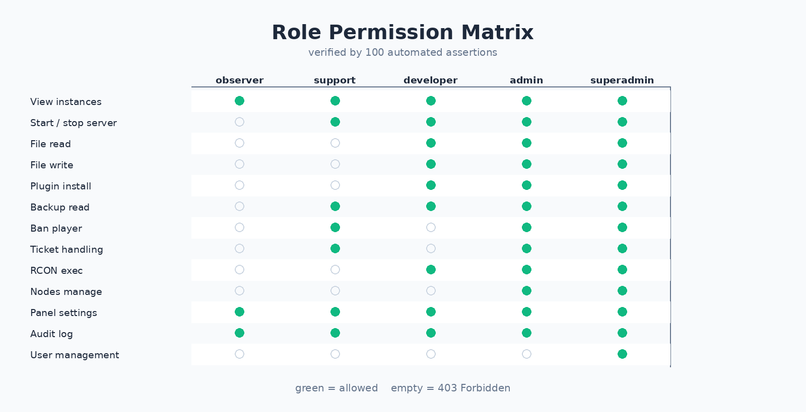
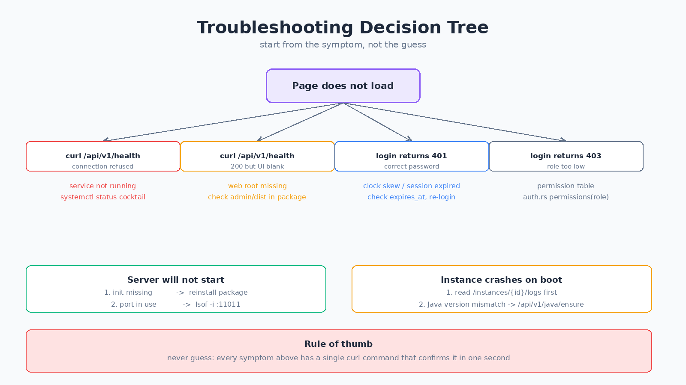

# Cocktail Manager 使用说明书

> 面向：第一次接触这个面板的人
> 读完大概 15 分钟，能完成从零到开一个服

---

## 一、五分钟看懂这是什么

你有一台服务器，想开个 Minecraft 服，让朋友进来玩。

传统做法：SSH 上去，装 Java，下 jar，写启动脚本，开 screen，记一堆命令……

用 Cocktail，你只需要：打开浏览器，点几下。



浏览器里看到的所有东西都是**控制面**给的。控制面自己不碰文件，真正干活的是它拉起来的小弟 `init`。

对你来说这意味着一件事：**就算面板进程出问题，也不会把你的世界文件写坏**。

---

## 二、三种装法，选一种

### 情况 A：Linux 服务器（推荐）

```bash
# Ubuntu / Debian
sudo dpkg -i cocktail_26.4.11.0_amd64.deb

# CentOS / Rocky
sudo rpm -ivh cocktail-26.4.11.0.x86_64.rpm

# 启动
sudo systemctl enable --now cocktail
```

打开浏览器访问 `http://你的IP:11011`。

### 情况 B：Windows 电脑

双击 msi 包，一路下一步。装完在桌面找到 Cocktail 图标，双击。

浏览器会自动打开。如果没有，手动访问 `http://127.0.0.1:11011`。

### 情况 C：不知道怎么装

看服务器提供商有没有“一键应用”。如果没有，选 A。

---

## 三、第一次打开：三步走完



### 第 1 步：看自检结果

页面会自动检查四项。**全绿就点下一步，有红先解决。**

红的可能原因：

| 哪项红 | 什么意思 | 怎么办 |
| --- | --- | --- |
| 数据库 | 目录没写权限 | 让运行用户有 data 目录权限 |
| init | 安装包不全 | 重新装一次 |
| 平台 | 显示你的系统 | 这是信息，不是错误 |

### 第 2 步：起个名字

填「张三的服」之类的，只显示在页面顶部，随时可改。

### 第 3 步：创建你的账号

用户名 + 密码。路线图会告诉你密码强不强。

**别用 `123456`、`password`、`admin`。** 这种密码几分钟就被扫开了。

这个账号是最高权限，你之后可以用它创建别的账号给一起管服的人。

> 忘了密码？服务端执行 `cocktail-control --reset-password`。

---

## 四、开第一个服

左侧点「实例」，然后「新建实例」。



### 就填四项

| 项目 | 填什么 |
| --- | --- |
| 名字 | 「生存服」 |
| 类型 | **新手选 Paper** |
| 版本 | 选最新的就行 |
| 内存 | 2G 起步 |

其它默认。

### 为什么推荐 Paper

| 类型 | 能装插件 | 能装模组 | 性能 |
| --- | --- | --- | --- |
| 原版 | 否 | 否 | 一般 |
| **Paper** | **是** | 否 | **好** |
| Fabric | 是 | 是 | 好 |
| Forge | 是 | 是 | 一般 |

Paper 能装插件、性能好，是大多数人的选择。想玩模组再选 Fabric/Forge。

### 创建后会发生什么

1. 自动下载服务端 jar（几十到几百 MB，看你网速）
2. 自动同意 EULA\*
3. 自动生成基础配置
4. 自动检查 Java 版本

\* 关于 EULA：Minecraft 的服务端需要你同意一份许可协议。面板代你写了 `eula=true`，等于你已阅读并同意。自己开服就是这样的。

---

## 五、启动和游玩

### 点启动，等三个状态

```
已创建 -> 启动中 -> 运行中
```

- **启动中**：正在加载世界，大世界要几十秒
- **运行中**：可以进了
- **崩溃**：起不来，去看日志

### 怎么进去玩

在 Minecraft 客户端里，添加服务器，地址填：

```
你的服务器IP:25565
```

如果是本机测试，填 `127.0.0.1:25565`。

### 怎么关服

点「停止」。

**面板会优雅关闭**：先告诉服务器保存世界再退出。

千万不要直接拔电源、直接 `kill`。世界文件会损坏，一切白玩。

---

## 六、让朋友能进来

### 检查三件事

| 检查 | 怎么做 |
| --- | --- |
| 端口放行 | 防火墙开 25565 |
| 服务器在跑 | 面板上状态是绿的 |
| 地址对 | 用公网 IP，不是 192.168.x.x |

### 如果朋友还是进不来

1. 自己先用 `127.0.0.1:25565` 试，能进说明服务没问题
2. 用公网 IP 试，不能进说明是网络/防火墙
3. 云服务器记得看「安全组」，那是另一层防火墙

---

## 七、装插件（可选）

「实例 → 插件」，搜你想装的，点安装。

常用的几个：

| 插件 | 干什么 |
| --- | --- |
| EssentialsX | 基础命令（家、传送、经济） |
| LuckPerms | 权限管理 |
| WorldEdit | 造建筑神器的 |
| CoreProtect | 防熊孩子必备，能回滚破坏 |

**装完重启服务器才生效。**

---

## 八、管人

### 看谁在线

「实例 → 玩家」，能看到当前在线列表。

### 踢人

点「踢出」，对方会看到「你被踢出服务器」。

### 封人

两种：

| 方式 | 在哪 | 效果 |
| --- | --- | --- |
| 单服封禁 | 实例 → 玩家 | 只在这个服进不来 |
| **全局封禁** | 社区 → 全局封禁 | **所有服都进不来** |

全局封禁更彻底。可以按玩家名、IP 或 UUID 封。

设置解封时间两种方式：

- 填小时数：`24` 就是一天后自动解封
- 选具体时间：比如选「后天 18:00」

### 处理申诉

玩家申诉会出现在「社区 → 工单」。

按状态筛选：

```
全部  待处理  处理中  已通过  已驳回
```

看到待处理的，点「认领」，处理完点「通过」或「驳回」。

---

## 九、备份：最重要的一件事

### 为什么必须备份

Minecraft 的世界是最难恢复的东西：

- 熊孩子把家炸了
- 插件冲突把区块搞坏了
- 更新服务端后世界读不出来

有备份就能一键回到昨天。

### 怎么备份

「实例 → 备份」→「创建备份」。

### 什么时候备份

```
[ ] 装新插件之前
[ ] 改配置之前
[ ] 升级服务端版本之前
[ ] 大活动（比赛、开新区）之前
```

### 自动备份

「自动化」里设一个定时任务：每天凌晨 3 点备份。

---

## 十、给别人开账号

「设置 → 用户」→「新建用户」。

### 选什么角色



| 他是谁 | 选什么 |
| --- | --- |
| 只想看数据的朋友 | 观察员 |
| 帮你处理玩家投诉的 | 客服 |
| 会改配置装插件的 | 开发者 |
| 一起管服务器的 | 管理员 |
| 只有你自己 | Owner |

> 注意：管理员也不能创建管理员。只有 Owner 能。这是防止有人偷偷给自己提权。

---

## 十一、装到手机上

打开面板后，浏览器菜单里选「添加到主屏幕」。

之后就像 App 一样从桌面点开，全屏显示。

---

## 十二、出问题了



### 页面打不开

```bash
curl http://127.0.0.1:11011/api/v1/health
```

| 返回 | 意思 |
| --- | --- |
| 一段 JSON | 服务正常，问题在浏览器 |
| 连不上 | 服务没跑，`systemctl start cocktail` |
| 一直转圈 | 防火墙挡了 |

### 服起不来

直接看日志：「实例 → 日志」，最后几行就是原因。

| 日志说 | 怎么办 |
| --- | --- |
| `UnsupportedClassVersion` | Java 版本低，装新版 |
| `Failed to bind to port` | 端口被占，换一个 |
| `agree to the EULA` | 面板里点同意 |
| `OutOfMemoryError` | 内存太小，调小 `-Xmx` |

### 服突然崩了

状态会变红。日志还在，先看日志。

最常见的两个原因：内存不够、某个插件报错。

---

## 十三、几个新手常问

**Q：能开几个服？**

看机器。一个服建议 2G 内存，8G 机器开 3 个比较稳。

**Q：面板关了，服会停吗？**

会。所以用 systemd 托管，别用 `nohup &`。

**Q：能换成正版服吗？**

能。配置里把 `online-mode` 改成 `true`，重启。这样只有买了正版的人能进。

**Q：世界能导出吗？**

能。「实例 → 世界」，可以下载或导出压缩包。

**Q：换了服务器，世界怎么办？**

旧机下载世界，新机装面板建个空实例，把世界传上去，启动。

**Q：升级面板会不会丢数据？**

不会，会自动迁移。但建议升级前备份 `data/` 目录。

---

## 十四、安全三件事

这三件不做，等于给陌生人开门：

1. **别用弱密码。** 至少 12 位，大小写+数字+符号。
2. **前面加 HTTPS。** 用 Nginx 或 Caddy 做一层 TLS，否则密码明文传输。
3. **不要直接把 11011 暴露到公网。** 至少限制来源 IP。

---

## 十五、下一步

现在你已经能开服了。想深入看：

| 想看什么 | 看哪份文档 |
| --- | --- |
| 完整功能说明 | 用户手册 |
| 具体命令、部署、运维 | 操作手册 |
| 为什么这样设计 | 设计说明书 |

---

祝开服顺利。

